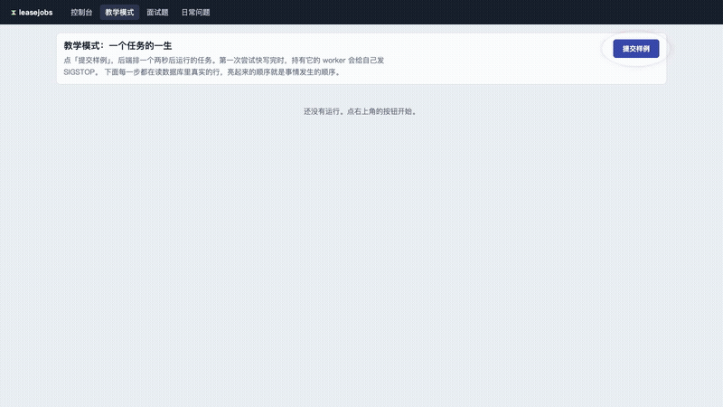
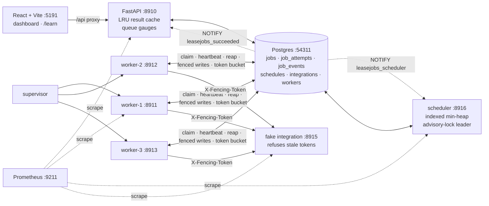

# leasejobs

A Python background-job service where Postgres leases decide who runs a job, fencing tokens make a presumed-dead worker's late writes bounce, and a min-heap scheduler plus a shared token bucket keep waiting jobs off the workers.



Walkthrough videos (Chinese, split by chapter, narration synthesized locally with TTS): [docs/videos/](docs/videos/README.md) · Tutorial: [`docs/tutorial/`](docs/tutorial/) · Interview questions: [`docs/interview.md`](docs/interview.md) · Problems I hit and how I fixed them: [`docs/problems.md`](docs/problems.md)

## What it does

- **REST API** (FastAPI): submit, query, list, cancel jobs; attempt history; the full lease timeline of a job; results with an LRU cache in front. API keys map to owners; other owners' jobs are 404.
- **Lease-based workers**: claim with one `UPDATE … WHERE id = (SELECT … FOR UPDATE SKIP LOCKED)`, bump `fencing_token`, heartbeat to extend the lease. Any live worker reaps expired leases before claiming.
- **Fencing tokens everywhere a worker writes**: heartbeats, start, finish in Postgres (`lease_owner = me AND fencing_token = mine`), and the `X-Fencing-Token` header to the external integration, which refuses tokens older than one it has seen.
- **Explicit state machine**: `SCHEDULED → PENDING → LEASED → RUNNING → SUCCEEDED | FAILED_RETRYABLE → SCHEDULED | FAILED_TERMINAL | TIMED_OUT | CANCELLED`, enforced in Python *and* by a Postgres trigger, with a test that the two edge lists are identical.
- **Scheduler**: an indexed binary min-heap (remove / re-prioritise in O(log n)) over delayed jobs and cron / fixed-interval schedules, with `skip` / capped `catch_up` misfire policies, `pg_notify` wake-ups, rebuild-from-Postgres on start, and advisory-lock leadership.
- **Per-integration rate limits**: one token bucket row per integration in Postgres, shared by all workers, refilled lazily in the same statement that takes a token. No token → the job goes back to the scheduler; the worker is not blocked.
- **Hand-written O(1) LRU** (hash map + doubly linked list + sentinels) for immutable results, filled read-through and warmed by a `pg_notify` on success.
- **Retries, timeouts, cancel**: exponential backoff with jitter through the scheduler, hard per-attempt deadlines enforced by the worker even when a job ignores them, cancellation delivered through the heartbeat.
- **Ops**: `/healthz` vs `/readyz` on every process, Prometheus metrics (backlog by state, oldest runnable age, attempts by outcome, failure rate, stalled jobs by reason), alert rules, a supervisor that restarts dead workers, structured JSON logs, [`docs/setup.md`](docs/setup.md) and [`docs/troubleshooting.md`](docs/troubleshooting.md).
- **Teaching mode** (`/learn`): one button runs a sample job whose first holder SIGSTOPs itself before committing; eleven stages light up from real `job_events` rows, each with its data, a source link pinned to the build's commit, and a video slot.

## Architecture



The Python processes run on the host from `.venv` so that "kill a worker" is a real PID on the machine; only Postgres and Prometheus run in containers (compose project `leasejobs`, ~512 MiB of limits).

## Run it

```bash
./scripts/demo.sh     # compose up, venv, migrate, seed, integration, API, scheduler, 3 workers, web UI
open http://localhost:5191/learn
./scripts/stop.sh     # stops exactly the PIDs demo.sh wrote, then docker-compose -p leasejobs stop
```

`demo.sh` works on an empty volume (`docker-compose -p leasejobs down -v` first). API key for curl: `X-API-Key: dev-key-alice` (a local placeholder). Ports and env vars: [`docs/setup.md`](docs/setup.md).

## Why these choices

- **Postgres as the coordinator.** A lease is three columns on a row; claim, renew, reap and finish are each one conditional `UPDATE` in the same transaction as the state change and its event row. A log-based broker can't express "this job is held by W until T", and a cache-based lock would need a second store for state and history.
- **Database clock for leases.** `lease_expires_at = now() + ttl` and expiry checks use `now()`, so worker clock skew can't create two holders.
- **Reaping by any live worker, not a dedicated reaper.** Recovery must not depend on the process that died, or on one more process staying alive.
- **Fencing even though we reap.** "Expired" is a guess: the old holder may be paused, not dead. The token is what makes its late writes harmless, and it has to reach the system with the side effect, not just our table.
- **A shared bucket in Postgres, not one bucket per worker process.** The limit belongs to the integration. Per-process buckets make the real rate N × configured and change it every time workers scale. The cost is one short row-locked statement per call, fine for calls that are rate-limited to a few per second anyway. Refused jobs are handed back to the scheduler (`LEASED → SCHEDULED`), spread over `(queued + 1) / refill_per_s`, so no worker thread waits on a bucket.
- **An indexed heap, not `heapq`.** Cancelled delayed jobs and moved schedules must leave the heap without tombstones. The heap is only an index; Postgres stays the truth and the heap is rebuilt on start and every 15 s.
- **A hand-written LRU.** To show where O(1) comes from. Results are immutable after `SUCCEEDED`, so the cache never needs invalidation. In production I would use `OrderedDict` (see the numbers below: it is faster).

## Tests

```bash
docker-compose -p leasejobs up -d --wait postgres
.venv/bin/python -m pytest              # 162 tests, real Postgres, real worker processes
./scripts/failing_controls.sh          # each protection off -> red, back on -> green
npx playwright test -c e2e             # UI end to end, needs demo.sh running
```

What is covered: the state machine (all 81 from/to pairs, the trigger, Python = SQL), claim concurrency (4 processes × 400 jobs, every job body runs exactly once), `SKIP LOCKED` really skipping, kill -9 recovery with history intact, SIGSTOP + SIGCONT with the stale write refused in Postgres and downstream, delayed and recurring scheduling, misfire policies, restart rebuild and slot idempotency, scheduler leadership, the global rate bound across 3 processes, deferral instead of blocking, retries / retry limits / timeouts / a job that ignores its deadline, cancellation via heartbeat, 5xx / 4xx / unreachable dependencies, invalid requests (401 / 404 / 409 / 422), stalled-job detection by reason, the supervisor restart, the learn flow, and the LRU and heap against reference models with hypothesis. Timing-related assertions are relative or derived from configuration (bucket bound, "not before run_at", same-machine size ratio), never a locally tuned millisecond threshold.

### Failing controls (measured)

`LEASEJOBS_LAB_SABOTAGE` switches one protection off; the test that guards it must go red, and green again when it is back. Output of `./scripts/failing_controls.sh` (full file: [`docs/results/failing-controls.txt`](docs/results/failing-controls.txt)):

<!-- failing-controls:start -->
```
=== lease reclaim (kill -9 recovery)  LEASEJOBS_LAB_SABOTAGE=no_reclaim  expect=red got=red  [OK]
E       AssertionError: timed out after 15s waiting for another worker to reclaim and finish the job; saw {'state': 'RUNNING', 'lease_owner': 'w1', 'fencing_token': 1,...
FAILED tests/test_recovery.py::test_kill9_worker_job_is_reclaimed_with_history_intact
1 failed in 16.04s
=== lease reclaim (kill -9 recovery)  LEASEJOBS_LAB_SABOTAGE=<none>  expect=green got=green  [OK]
1 passed in 5.78s
=== fencing token (in-process stale write)  LEASEJOBS_LAB_SABOTAGE=no_fencing  expect=red got=red  [OK]
E       AssertionError: stale worker overwrote the result: {'by': 'w-a'}
E       assert {'by': 'w-a'} == {'by': 'w-b'}
FAILED tests/test_recovery.py::test_stale_holder_cannot_heartbeat_or_finish
1 failed in 0.54s
=== fencing token (in-process stale write)  LEASEJOBS_LAB_SABOTAGE=<none>  expect=green got=green  [OK]
1 passed in 0.60s
=== fencing token (SIGSTOP + revive, downstream)  LEASEJOBS_LAB_SABOTAGE=no_fencing  expect=red got=red  [OK]
E       AssertionError: accepted writes: [{'token': None, 'at': 1795664965.135, 'integration': 'ledger-api', 'job_id': 1, 'attempt': 2, 'worker': 'w2', 'amount': 1}, {...
E       assert ['w2', 'w1'] == ['w2']
FAILED tests/test_recovery.py::test_sigstop_worker_revives_and_is_fenced_out
1 failed in 4.29s
=== fencing token (SIGSTOP + revive, downstream)  LEASEJOBS_LAB_SABOTAGE=<none>  expect=green got=green  [OK]
1 passed in 4.28s
=== shared token bucket (global rate)  LEASEJOBS_LAB_SABOTAGE=no_ratelimit  expect=red got=red  [OK]
E       AssertionError: more calls than the bucket allows
E       assert 12.732000350952148 <= 1.0
FAILED tests/test_ratelimit.py::test_shared_bucket_holds_the_global_rate_across_three_workers
1 failed in 2.39s
=== shared token bucket (global rate)  LEASEJOBS_LAB_SABOTAGE=<none>  expect=green got=green  [OK]
1 passed in 9.16s
```
<!-- failing-controls:end -->

## Measured numbers (this repo only)

All from [`docs/results/`](docs/results/), median of 5 runs unless noted, on a laptop with Postgres 16 in colima (4 vCPU / 6 GiB shared with other projects), workers on the host. Treat them as same-machine comparisons, not capacity claims.

| what | result |
|---|---|
| kill -9 the holder → another worker holds the job (TTL 4 s, heartbeat 1 s) | **3.59 s** (min 3.57, max 3.60); → `SUCCEEDED` of a 2 s job: 5.61 s |
| no-op jobs claimed + run, `SKIP LOCKED` | 1 worker 75/s · 4 workers 285/s · 8 workers 478/s, 0 duplicate attempts |
| same, plain `FOR UPDATE` | 85/s · 293/s · 332/s, 0 duplicate attempts (no difference until 8 workers) |
| LRU get+put, 1 000 → 100 000 entries | ours 567 → 699 ns/op (flat: O(1)); `OrderedDict` version 143 → 290 ns/op (faster: C) |
| rate-limit deferrals, 16 jobs, bucket 3 + 2/s, 3 workers (3 runs) | 91 → 22 after spreading refused jobs by backlog; wall time 6.54 s → 6.96 s (floor 6.5 s) |
| global rate bound, same test | worst excess over `capacity + rate·t` ≤ 0.25 calls with the bucket; 12.7 with it off |

Files: [`bench.txt`](docs/results/bench.txt) (`scripts/bench.py`), [`ratelimit-deferrals.txt`](docs/results/ratelimit-deferrals.txt), [`failing-controls.txt`](docs/results/failing-controls.txt).

## What this is not

- **Not exactly-once side effects.** Fencing guarantees the *last* write that lands belongs to the newest lease. If the old holder wakes up early enough, the downstream can receive both writes; real exactly-once needs the downstream to be idempotent by job id.
- **Not hard isolation.** Jobs run in threads; a job that ignores its deadline is abandoned, not killed. Hard isolation needs a subprocess per attempt.
- **Not tuned for volume.** Every heartbeat writes a `job_events` row (so the timeline can show it); events and attempts have no retention policy; one Postgres is the ceiling. See the scaling questions in [`docs/interview.md`](docs/interview.md).
- **Not production auth.** API keys are sha256-hashed and owner-scoped, with no rotation or roles; worker admin endpoints bind to 127.0.0.1 without auth.
- **Not deployed.** Host processes plus two containers; no Dockerfile or manifests; Prometheus has alert rules but no Alertmanager; Grafana is a dashboard JSON to import ([`deploy/grafana/`](deploy/grafana/)).
- The CI workflow ([`.github/workflows/ci.yml`](.github/workflows/ci.yml)) has not run on GitHub yet; every step in it was run locally.

## Layout

```
leasejobs/   api.py  lease.py  worker.py  scheduler.py  heap.py  cron.py  schedules.py
             ratelimit.py  cache.py  states.py  store.py  metrics.py  learn.py
             integration.py (fake downstream)  supervisor.py  migrate.py  seed.py
sql/         001_core … 007_learn          migrations, triggers, the transition table
tests/       pytest against real Postgres and real processes
frontend/    React + Vite + TS: dashboard, /learn, /learn/interview, /learn/problems
e2e/         Playwright
video/       narration.json, parts.json, record.mjs, check_frames.mjs, problems.src.json
docs/        tutorial/ (9 chapters, tags step-01…step-09), interview.md, problems.md, setup.md, troubleshooting.md, results/
```

## License

MIT
